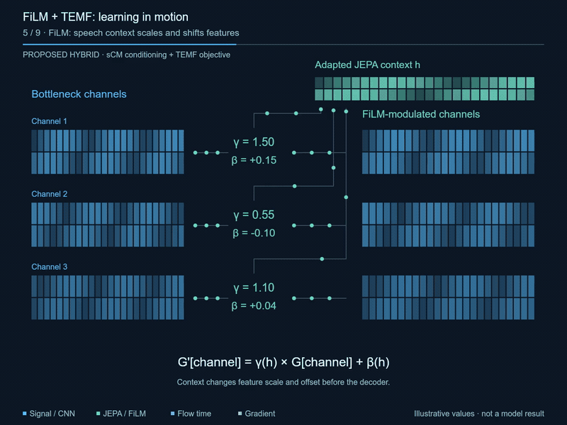

# TEMF + WavJEPA-Nat

**Speech restoration with pretrained audio context and mean-flow generation.**

A **325.5M-parameter** restoration model combines SGMSE NCSN++ with frozen
WavJEPA-Nat features to learn from aligned clean and degraded speech. At inference,
it takes only the degraded recording and supports one-step or multi-step sampling.

## What makes it different

- **Context-guided restoration.** FiLM adapters bring WavJEPA-Nat audio features
  into the restoration network. The encoder stays frozen.
- **Direct mean-flow prediction.** The model predicts velocity using the pinned
  TEMF objective, time schedules, and full derivatives. Time controls use RMS normalization.
- **Reproducible experiments.** Lightning/Hydra training and evaluation, optional
  audio augmentation, resumable data loading, EMA checkpoints, and STOI evaluation.

**Status:** the scaffold is CPU smoke-tested. Full-model training, GPU performance,
and real-speech quality are not yet validated. The parameter count excludes the
frozen encoder.

## Get started

Use Python 3.11 or 3.12 in an isolated environment:

```sh
python -m pip install -e '.[dev,augment]'
python -m src.upstream.fetch
TORCH_DEVICE_BACKEND_AUTOLOAD=0 python -m src.train experiment=smoke
```

This runs a tiny synthetic CPU example. Real training needs data manifests and
pinned WavJEPA-Nat weights; follow the [training guide](docs/training.md).

## Documentation

- [Project structure and configuration](docs/project-structure.md)
- [Training and sampling explained](docs/training-and-sampling.md)
- [Data augmentation](docs/augmentation.md)
- [WavJEPA-Nat conditioning](docs/wavjepa-nat.md)
- [Upstream sources and adaptations](third_party/README.md)
- [Mathematical proofs and scope](lean/README.md)

[](docs/media/film-temf-scm-motion.mp4)

[Watch the 2:28 animation](docs/media/film-temf-scm-motion.mp4) — a toy illustration
of the method, not a trained-model result. [Details](docs/animation/README.md).

## Citation

If you use this code in research or build on this implementation, please cite this
repository using [CITATION.cff](CITATION.cff). Include the commit or release you used
so others can reproduce your results.

```bibtex
@software{temf_wavjepa_nat,
  author = {{TEMF + WavJEPA-Nat contributors}},
  title = {{TEMF + WavJEPA-Nat}},
  url = {https://github.com/quangng2000/temf-wavjepa-film}
}
```

Please also cite the relevant original methods and implementations listed in
[Upstream sources and adaptations](third_party/README.md).
